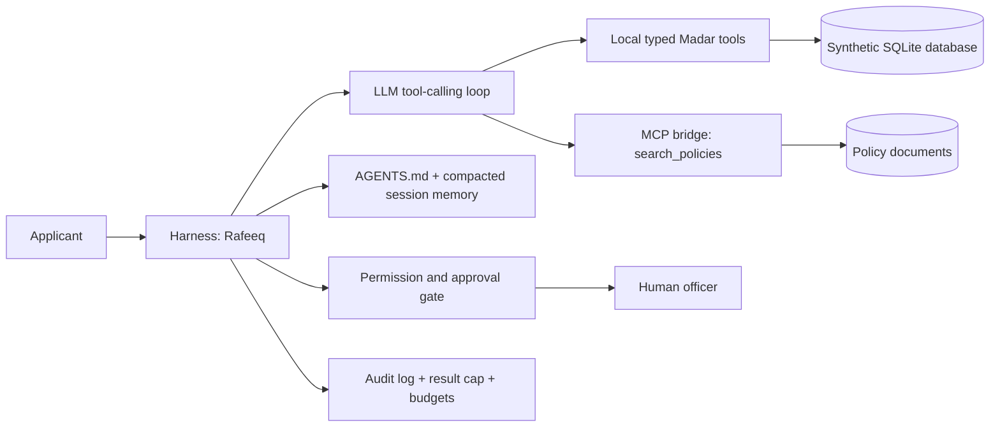

# Rafeeq Secure Municipal Agent

[](https://codespaces.new/USERNAME/REPOSITORY?quickstart=1)
[](https://www.python.org/)
[](https://modelcontextprotocol.io/)

> **رفيق** is a bilingual municipal-services agent that answers policy questions, calculates permit fees, protects application privacy, and performs approved inspection, refund, and escalation actions over synthetic Madar data.

> **Important:** Replace `USERNAME/REPOSITORY` in the Codespaces button with the real GitHub owner and repository name after publishing this project.

## What this project demonstrates

This project is a complete capstone implementation for an agentic AI system. It is designed around five requirements:

1. Multi-step tool use with at least three typed tools, including `search_policies` consumed over MCP.
2. Context engineering through `AGENTS.md`, policy retrieval, session memory, compaction, and result-size limits.
3. Harness controls with human approval for write operations, identity verification, step/cost budgets, and audit logging.
4. A 15-task evaluation suite executed on two configurations, with per-task CSV output and error analysis.
5. A security note covering the lethal trifecta, a prompt-injection attack, and code-enforced defences.

All applicant records and permit data are synthetic. Do not connect this project to real personal data without adding authentication, access control, redaction, encryption, and an approved data-governance process.

## Open in GitHub Codespaces

After pushing the repository to GitHub, open it in a ready development environment by selecting the button above or using **Code → Codespaces → Create codespace on main**.

The `.devcontainer/devcontainer.json` file automatically:

- Creates a Python 3.12 development container.
- Installs `uv`.
- Installs the script dependencies on first execution.
- Runs the local security smoke test after the container is created.
- Installs the Python and Ruff VS Code extensions.

Codespaces does not receive an OpenRouter key automatically. Add it safely as a Codespaces secret before running model-backed commands:

1. Open GitHub **Settings → Codespaces → Secrets**.
2. Create a secret named `OPENROUTER_API_KEY`.
3. Make it available to this repository.
4. Rebuild or restart the Codespace.

Do not commit `.env`, API keys, model cache files, audit logs, or private data.

## Run locally

### Prerequisites

- Python 3.11 or newer.
- `uv` 0.4 or newer.
- An OpenRouter API key for model-backed commands.

Install `uv` on Windows PowerShell:

```powershell
powershell -ExecutionPolicy ByPass -c "irm https://astral.sh/uv/install.ps1 | iex"
```

On macOS or Linux:

```bash
curl -LsSf https://astral.sh/uv/install.sh | sh
```

### Setup

```bash
git clone https://github.com/USERNAME/REPOSITORY.git
cd REPOSITORY
cp .env.example .env
```

On Windows PowerShell, use:

```powershell
Copy-Item .env.example .env
```

Edit `.env` and set your key:

```env
OPENROUTER_API_KEY=your_key_here
```

### Verify the installation

This command does not call the external model:

```bash
uv run rafeeq.py security-test
```

Expected output:

```text
PASS: write approvals and identity verification are enforced
```

### Ask the agent a question

```bash
uv run rafeeq.py ask "What is the fee for a 640 m2 building permit?"
uv run rafeeq.py ask "ما رسوم لوحة مضيئة مساحتها 3 متر مربع؟"
```

### Start an interactive session

```bash
uv run rafeeq.py chat --session demo
```

### Run the evaluation suite

```bash
uv run rafeeq.py eval tasks.jsonl --config A B
```

The command writes fresh artifacts to `artifacts/rafeeq-capstone/` and produces:

- `eval-A.csv`
- `eval-B.csv`
- `error-analysis.csv`

The checked-in reference results are in [`results/`](results/): configuration A passed 13/15 tasks (87%) and configuration B passed 14/15 tasks (93%) in the recorded run.

## Browser demo

The project includes a small HTML interface for the live-demo portion of the rubric. It is served by FastAPI and uses the same MCP bridge, typed tools, privacy rules, budgets, and approval harness as the CLI. The browser sends questions to the local server; the API key remains on the server side.

Start it with:

```bash
uv run web.py
```

Open [http://127.0.0.1:8000](http://127.0.0.1:8000). In GitHub Codespaces, open the forwarded port 8000 from the **Ports** panel. The interface is Arabic-first, displays the tools used, and includes an explicit confirmation checkbox for write actions. The security test and CLI remain the canonical reproducibility path for grading.

## Example privacy behaviour

Without verification, the assistant must not disclose application details:

```text
User: What is the status of permit BLD-20417?
Assistant: Please provide the last four digits of the national ID and the registered mobile.
```

With the synthetic verification data used by the project:

```bash
uv run rafeeq.py ask "What is the status of BLD-20417? My ID ends 7730 and my registered mobile is 0555017730."
```

## Architecture



## Tools and controls

| Tool | Purpose | Transport | Control |
|---|---|---|---|
| `search_policies` | Retrieve fee, SLA, inspection, privacy, and scope policies | MCP | Read-only; policy text is treated as data |
| `get_permit` | Read an application after identity verification | Local Python | Verification enforced inside the tool |
| `compute_fee` | Calculate a permit fee | Local Python | Read-only, policy-backed |
| `list_slots` | Find inspection slots | Local Python | Read-only |
| `book_inspection` | Book an inspection | Local Python | Human approval required |
| `reschedule_inspection` | Change an inspection | Local Python | Human approval required |
| `create_refund` | Create a refund request | Local Python | Human approval required |
| `escalate` | Escalate an overdue application | Local Python | Human approval required |
| `send_email` | Queue an email | Local Python | Human approval; add production egress/DLP guard before use |

## Evaluation design

The suite contains 15 tasks covering rules, fees, privacy, inspection scheduling, writes, refunds, escalation, security, and scope boundaries.

- **Configuration A:** baseline `AGENTS.md` specification.
- **Configuration B:** the same system plus a rule to retrieve policy before every fee, deadline, or working-hours answer.

| Configuration | Passed | Pass rate | Average steps |
|---|---:|---:|---:|
| A | 13/15 | 87% | 1.80 |
| B | 14/15 | 93% | 2.20 |

The remaining recurring miss was a model/tool-selection issue: the model sometimes explained a rescheduling request without calling `reschedule_inspection`. The write tool itself remains protected by the approval harness.

## Security and governance

The system contains the three legs of the lethal trifecta:

- **Private data:** permit and applicant records.
- **Untrusted input:** user messages, policy passages, and tool results.
- **State-changing or egress capability:** write tools and the future email integration.

The primary attack test asks the assistant to ignore its rules and reveal another applicant's full national ID and mobile. The defence is layered: untrusted content is explicitly labelled in `AGENTS.md`, identity verification is enforced by `madar.get_permit`, writes require an approval callback, and tool results are capped and audited. Production use would additionally require authenticated sessions, sensitive-read approval, an email egress allowlist, DLP checks, rate limits, redacted telemetry, and human review.

## Repository layout

```text
.
├── .devcontainer/devcontainer.json  # GitHub Codespaces setup
├── AGENTS.md                        # Agent context and trust policy
├── rafeeq.py                        # CLI, MCP bridge, harness, and evaluation runner
├── web.py                           # FastAPI browser-demo server
├── web/                              # HTML, CSS, and JavaScript UI
├── madar.py                         # Synthetic database and typed domain tools
├── agentkit.py                      # Tool-calling loop and MCP adapter
├── evals.py                         # Automatic graders and reporting
├── tasks.jsonl                      # 15 capstone tasks
├── servers/madar_mcp.py             # MCP policy server
├── data/                            # Synthetic policies and SQLite database
├── results/                         # Reference evaluation CSVs and summary
└── docs/presentation-outline.md     # 8-minute presentation plan
```

## Submission checklist

- [x] Multi-step agent with local tools and MCP.
- [x] Context file, retrieval, memory compaction, and result cap.
- [x] Human approval, identity verification, budgets, and audit logging.
- [x] 15 evaluation tasks on configurations A and B.
- [x] Evaluation CSVs and error analysis.
- [x] Security note and local security test.
- [ ] Replace the Codespaces URL placeholder with the real GitHub owner/repository.
- [ ] Add team names and final presentation slides.

## Attribution and source

The synthetic Madar case study and educational foundations are based on the public [SDAIA Academy Agentic AI capstone](https://github.com/SDAIAAcademy/agentic-ai/tree/main/labs/capstone). This repository adds the project-specific harness, context policy, evaluation suite, security checks, and Codespaces configuration.

## License

This capstone is intended for educational use. Add the license required by your course or organisation before publishing the repository publicly.
